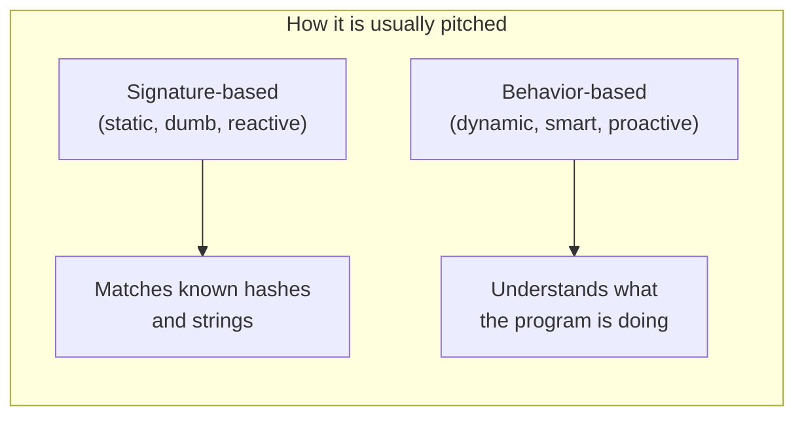
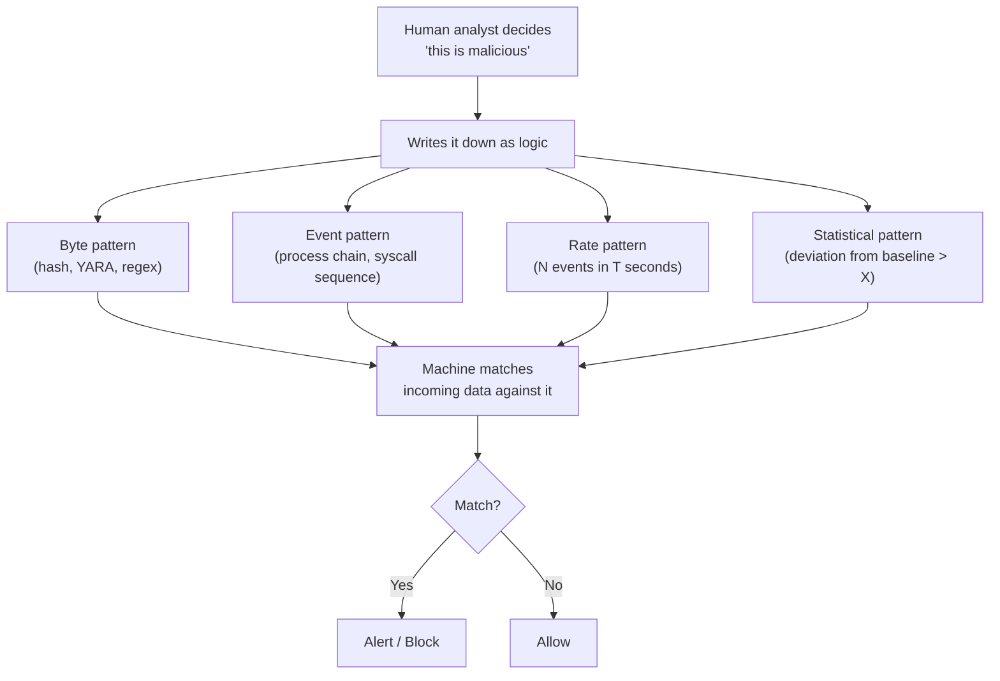
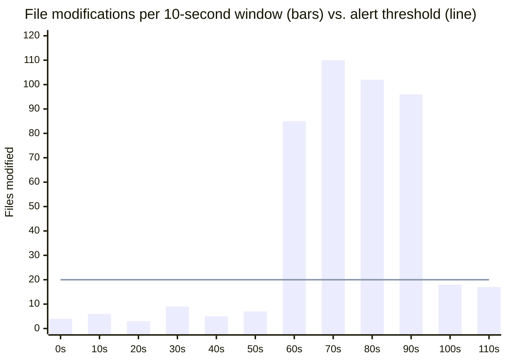
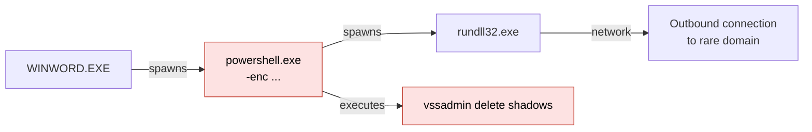
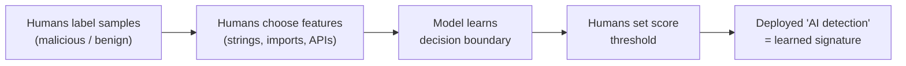
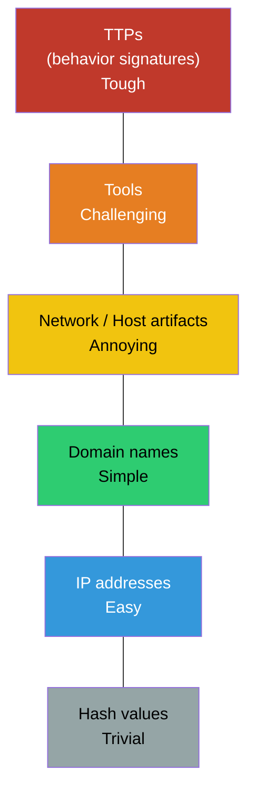
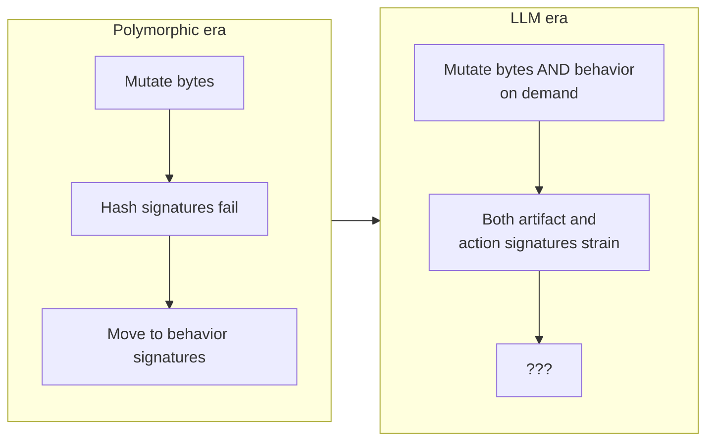

_Why "behavioral detection" is still pattern matching, just with better marketing_

Walk through any security conference expo hall, scroll any vendor landing page, or sit through any product demo, and you will hear the same story told two ways. There is the **old way**, signature-based detection, which is described as rigid and reactive. And there is the **new way**, behavioral detection, which is described as smart, adaptive, and able to catch threats nobody has seen before.

It is a clean story. It sells well. And I think it is mostly a story.

My argument in this article is simple: **behavioral detection is still signature detection.** A behavior rule is a signature written over actions instead of bytes. The computer does not "understand" that a behavior is bad. A human decided it was bad, wrote that decision down as logic, and the machine matches against it. That is exactly what a signature is.

That does not make behavioral detection useless. It makes it honest. And once we see it honestly, we can have a much better conversation about what our security tools actually do, where they break, and why the arrival of LLM-driven attackers matters so much.

---

## Part 1: The two stories vendors tell

Let's first lay out the standard picture, the way it is usually pitched.

### Story one: signature-based detection

A signature is a known fingerprint of something bad. The simplest version is a **file hash**. Security teams compute the SHA-256 of a known malware sample, put it on a blocklist, and every file on disk is compared against that list. Match? Malicious.

A slightly smarter version looks _inside_ files for **strings or byte patterns**. A YARA rule, for example, might say "if a file contains this mutex name, this ransom-note phrase, and this specific byte sequence, flag it":

```yara
rule Example_Ransomware_Strings
{
    strings:
        $note  = "All your files have been encrypted" ascii wide
        $mutex = "Global\\XYZ_LOCK_2024" ascii
        $hex   = { 6A 40 68 00 30 00 00 6A 14 }
    condition:
        2 of them
}
```

The weakness is obvious: change one byte and the hash changes. Rename the mutex and the string match fails. This is why vendors call signatures "reactive."

### Story two: behavioral detection

Behavioral detection, as marketed, ignores what a file _is_ and watches what it _does_. Instead of asking "does this match a known bad file?", it asks questions like:

- Is this process modifying hundreds of files in a few seconds?
- Did Microsoft Word just spawn PowerShell?
- Is something deleting Volume Shadow Copies?
- Is a process calling `VirtualAllocEx` and `WriteProcessMemory` into another process?

The pitch is that even brand-new, never-seen-before malware has to _do_ something malicious eventually, so watching behavior catches what signatures miss.

Here is how that picture is usually drawn:



That second box, _"understands what the program is doing,"_ is where I disagree.

---

## Part 2: A computer cannot know what "bad" means

A computer can observe that a process opened 400 files in 10 seconds. It can count. It can compare numbers. What it cannot do, on its own, is decide that 400 files in 10 seconds is _wrong_.

Think about who else touches 400 files in 10 seconds: backup agents, antivirus scanners (ironically), compilers, `git checkout`, OneDrive syncing a folder, a photo editor batch-exporting a shoot. The raw behavior is morally neutral. "Bad" is a judgment, and judgments come from humans.

So somewhere, someone sat down and wrote something like:

> _If a single process modifies more than N files within T seconds, and the files are in user document folders, and the file extensions change, raise an alert._

Look at that sentence carefully. It has fixed fields, fixed thresholds, and fixed conditions. It is a pattern. If an event stream matches it, the alert fires. If it doesn't, nothing happens.

That is a signature. It is just a signature over a **sequence of events** instead of a **sequence of bytes**.



Every branch in that diagram starts at the same box: a human deciding. The only thing that changes is the _shape_ of the pattern being matched.

---

## Part 3: The evidence was there all along

This is not just my opinion. The people who built these systems have, often quite openly, described them in exactly these terms.

### Denning, 1987: the founding paper of behavioral detection

Dorothy Denning's [_An Intrusion-Detection Model_](https://faculty.nps.edu/dedennin/publications/IDS%20model.pdf) (IEEE Transactions on Software Engineering, 1987) is essentially the origin of anomaly and behavior-based intrusion detection. Her model builds **profiles** of how users and programs normally behave, and flags deviations from those profiles.

And yet, in describing her own behavioral model, Denning writes that it _"can be regarded as a rule-based pattern matching system."_ She also notes that the security officer helps establish the profile templates for which activities get monitored. In other words, the founding document of behavioral detection openly describes it as pattern matching, with a human choosing what to watch.

According to [Wikipedia's summary of SRI's IDES system](https://en.wikipedia.org/wiki/Dorothy_E._Denning), which grew out of this work, the system combined a rule-based expert system for known intrusions with a statistical anomaly component built on profiles. Even the "statistical" half was built on human-chosen metrics.

### Sigma: the behavior rule format that calls itself a signature format

[Sigma](https://github.com/SigmaHQ/sigma) is probably the most widely used open format for writing detection logic over logs. Its own README describes it as _"a generic and open signature format."_

Here is the interesting part. Sigma's "generic" rule category is explicitly meant to detect **behaviors**, techniques and procedures that attackers use, rather than specific malware. So the community's go-to tool for writing behavioral detections literally names itself a signature format. A Sigma rule for "Office application spawning a shell" looks like this:

```yaml
title: Office Application Spawning a Command Shell
logsource:
  category: process_creation
  product: windows
detection:
  selection:
    ParentImage|endswith:
      - '\WINWORD.EXE'
      - '\EXCEL.EXE'
    Image|endswith:
      - '\cmd.exe'
      - '\powershell.exe'
  condition: selection
level: high
```

That is a behavior. It is also, plainly, a string match on two fields.

### Wazuh: behavior and hashes in the same rule file

As a Wazuh Ambassador I'll pick an example close to home. Wazuh's own blog posts on ransomware, such as [detecting Medusa ransomware](https://wazuh.com/blog/detecting-medusa-ransomware-with-wazuh/) and [detecting Mamona ransomware](https://wazuh.com/blog/detecting-and-responding-mamona-ransomware-with-wazuh/), have sections describing the ransomware's _behaviour_, and then implement detection as XML rules containing regex field matches, `frequency` and `timeframe` counters, and MITRE ATT&CK tags.

Here is a simplified rule in the same style, a classic "mass file modification" behavioral detection:

```xml
<!-- "Behavioral" ransomware detection -->
<!-- Fires when file-modified events (rule 550) occur 20+ times in 60 seconds -->
<rule id="100200" level="12" frequency="20" timeframe="60">
  <if_matched_sid>550</if_matched_sid>
  <description>Possible ransomware: mass file modification</description>
  <mitre>
    <id>T1486</id>
  </mitre>
</rule>
```

And here is a classic "signature" detection, a hash lookup, written in the _same_ language, in the _same_ engine, by the _same_ human:

```xml
<!-- "Signature" detection: compare file SHA-256 against a known-bad list -->
<rule id="100201" level="15">
  <if_sid>550, 554</if_sid>
  <list field="sha256" lookup="match_key">etc/lists/malware-hashes</list>
  <description>Known malware hash detected: $(file)</description>
</rule>
```

Put them side by side and ask: what is the fundamental difference? One matches a value against a list. The other matches a count against a threshold. Both were authored by a person. Both are deterministic. Both can be evaded by anyone who knows the rule. The "behavioral" one is evaded by encrypting 19 files per minute instead of 20.

That number, **20 in 60 seconds**, is the signature.

### A behavioral graph, viewed honestly

Here is what that rate-based rule "sees." Normal activity fluctuates, ransomware spikes, and a human-drawn line separates them:



The bars from 60s to 90s are a noisy ransomware run, easily caught. The last two bars, sitting just under the line, represent a patient attacker throttling encryption to stay below the threshold. To the rule, those look identical to a user saving documents. The "behavior engine" did not miss them because it failed to understand intent. It missed them because **it never understood intent in the first place**. It only knew the line.

The same is true for process-chain behaviors. A detection graph like the one below looks intelligent, but every arrow on it corresponds to a field comparison someone wrote:



The two red nodes are where rules typically fire. They fire because someone wrote "ParentImage = WINWORD.EXE AND Image = powershell.exe" and "CommandLine contains 'delete shadows'." Change the parent, use a different LOLBin, or delete shadow copies via WMI instead of `vssadmin`, and you are in the same game as changing a byte to beat a hash.

---

## Part 4: This is not just an endpoint problem

The signature-versus-behavior framing appears across nearly every security product category, and the pattern repeats in each one.

**Web Application Firewalls.** My day job involves validating WAAP products, and this is where the illusion is easiest to see. The [OWASP Core Rule Set](https://coreruleset.org/docs/concepts/anomaly_scoring) runs in "anomaly scoring" mode by default. That sounds behavioral. In reality, individual rules (mostly regex patterns for SQLi, XSS, and so on) each add points when they match, and the request is blocked once the total crosses a configured threshold, five by default for inbound traffic. Microsoft's [Azure WAF documentation](https://learn.microsoft.com/en-us/troubleshoot/azure/application-gateway/troubleshoot-waf-anomaly-scoring-rule-949110-blocks) even points out that the final blocking rule, 949110, _"doesn't represent a specific attack signature."_ True. It is a sum of signatures compared against a human-chosen number.

**API security and bot management.** "Behavioral" bot detection usually means rate limits, request sequencing, header ordering, TLS fingerprints, and session velocity checks. Each is a pattern with a threshold. "More than 50 login attempts per minute from one ASN" is a signature over time.

**Network IDS.** Snort and Suricata are the textbook "signature" tools. But a so-called behavioral NDR product that flags "beaconing every 60 seconds with low jitter" is matching a periodicity pattern a human defined as suspicious.

**SIEM and UEBA.** User and Entity Behavior Analytics flags "impossible travel" or "user logged in at 3 AM from a new country." Someone decided that those specific deviations are worth alerting on, and someone chose how big the deviation must be.

**Cloud security.** "Suspicious behavior: IAM user created access key and then disabled CloudTrail" is a two-event sequence rule.

Different domain, same structure: **observe, compare to a human-defined pattern, decide.**

---

## Part 5: "But what about machine learning?"

This is the strongest counterargument, so it deserves a fair hearing. Machine learning models are not hand-written rules. They learn from data. Doesn't that break my argument?

I'd argue it moves the signature rather than removing it. A supervised model is trained on samples that humans labeled "malicious" or "benign." The model then learns a decision boundary, which is effectively a very large, very fuzzy signature, extracted automatically from human judgments. Humans also choose the features (strings? imports? entropy? API calls?), the training data, and the threshold at which a score becomes a block.

Robin Sommer and Vern Paxson made this point sharply in their influential 2010 IEEE S&P paper, [_Outside the Closed World_](https://www1.icsi.berkeley.edu/pubs/networking/outsidethe10.pdf). They argued that the common textbook premise, that anomaly detection is good at finding novel attacks, does not hold as broadly as people assume. Instead, they described the real strength of machine learning as _"finding activity that is similar to something previously seen"_, without anyone having to describe it precisely in advance. That is a beautiful description of a learned signature.

There is also a real-world demonstration. In 2019, researchers at [Skylight Cyber](https://skylightcyber.com/2019/07/18/cylance-i-kill-you/) reverse-engineered the machine learning model inside BlackBerry Cylance's "AI-based" antivirus. They found it leaned heavily on strings and showed a strong bias toward a particular video game that had been whitelisted. By appending strings from that game's executable to malware, they got the engine to score malicious files as benign. As [TechTarget reported](https://www.techtarget.com/cybersecurity/news/252467203/Researchers-fool-Cylance-AI-antimalware-with-simple-bypass), the researchers argued that understanding a model's features lets you _"fool it consistently, creating a universal bypass."_ (Cylance disputed the "universal" label and patched the issue.)

Read that again: an AI engine, sold as beyond signatures, was bypassed by **appending strings**. Its learned decision boundary was, functionally, a string signature that nobody had written down by hand.



---

## Part 6: Why it can never be anything else

There is a deeper, mathematical reason why detection always collapses into human-defined patterns.

In 1987, Fred Cohen published [_Computer Viruses: Theory and Experiments_](https://web.eecs.umich.edu/~aprakash/eecs588/handouts/cohen-viruses.html), the paper that gave us the formal definition of a computer virus. In it, he showed that, in general, _"detection of a virus is shown to be undecidable both by a-priori and runtime analysis."_

Note the phrase **runtime analysis**. Cohen was not only talking about static scanning. He was talking about watching behavior at runtime, too. As [this walkthrough of Cohen's proofs](https://0xjet.github.io/3OHA/2024/08/03/post.html) explains, Cohen showed that precise behavior-based detection inherits the same undecidability as static detection, and later work by Chess and White (2000) showed that undetectable viruses can exist.

The practical consequence is important. Since no general algorithm can perfectly decide "this program is malicious," every real product must approximate. It must pick a subset of the problem it _can_ decide, using fixed conditions. Those fixed conditions, picked by people, are signatures. The behavioral label describes _what_ is being matched, not a fundamentally different kind of reasoning.

---

## Part 7: So what _is_ the real difference?

I want to be fair here, because "it's all signatures" can sound like "it's all the same," and that is not my claim.

Behavioral signatures are genuinely more valuable than hash signatures. David Bianco's [Pyramid of Pain](http://detect-respond.blogspot.com/2013/03/the-pyramid-of-pain.html) (2013) explains why. It ranks indicators by how much it hurts an attacker when you detect them. Hashes sit at the bottom because they are trivial to change. Tactics, techniques, and procedures (TTPs) sit at the top. As Bianco put it, at the TTP level you are _"operating directly on adversary behaviors, not against their tools."_



Notice what the pyramid actually says, though. It does not say behaviors are a different _category_ from indicators. It puts them on the _same_ pyramid, as indicators, just at a different altitude. Behavior is the most expensive signature for an attacker to dodge, but it is still something a defender has to define and match.

So here is the vocabulary I'd propose instead of "signature vs behavior":

| What is matched                        | Example                                     | Who defines "bad"                  | How it is evaded              |
| -------------------------------------- | ------------------------------------------- | ---------------------------------- | ----------------------------- |
| **Artifact signatures** (nouns)        | Hash, string, YARA, regex                   | Human                              | Change the artifact           |
| **Action signatures** (verbs)          | Process chain, syscall sequence, Sigma rule | Human                              | Change the technique or order |
| **Rate signatures** (tempo)            | N events in T seconds                       | Human-set threshold                | Go low and slow               |
| **Statistical signatures** (deviation) | Baseline + "deviation > X is bad"           | Human-set assumption and threshold | Blend into the baseline       |
| **Learned signatures** (boundaries)    | ML classifier                               | Human labels, features, threshold  | Find the model's blind spots  |

The honest difference between "signature" and "behavioral" products is the **level of abstraction** at which the pattern lives, and therefore **how costly it is to evade**. It is not that one is static and the other "understands." Neither understands. Both match.

Why does this distinction matter rather than being just semantics? Because when buyers believe a product "understands malicious behavior," they stop asking the right questions:

- Which behaviors exactly are covered, and which are not?
- What are the thresholds, and who tuned them?
- What happens when the attacker changes the order, the tempo, or the tool?
- How was it tested against techniques that were _not_ in the vendor's rule set?

Those are the questions I ask every day in product validation work, and they are exactly the questions marketing language is designed to make you skip.

---

## Part 8: A hint of what's coming, the LLM problem

Everything above has been true for decades. What has changed is the attacker's ability to vary their patterns cheaply.

In November 2025, Google's Threat Intelligence Group [reported](https://cloud.google.com/blog/topics/threat-intelligence/threat-actor-usage-of-ai-tools) the first malware families using large language models _during execution_. One of them, **PROMPTFLUX**, is a VBScript dropper that calls the Gemini API to request obfuscation and evasion techniques, and one variant instructs the model to rewrite the malware's entire source code every hour. Another, **PROMPTSTEAL**, linked to APT28, queries an LLM to generate its reconnaissance commands on the fly rather than hard-coding them. GTIG called this _"a significant step toward more autonomous and adaptive malware."_

That same month, Anthropic [disclosed](https://www.anthropic.com/news/disrupting-AI-espionage) a state-sponsored espionage campaign, designated GTG-1002, in which attackers used an AI coding agent to carry out an estimated 80 to 90 percent of the tactical work across roughly thirty targets, with humans stepping in only at key decision points.

The industry's response has been predictable. As one expert told [Infosecurity Magazine](https://infosecurity-magazine.com/news/aienabled-malware-actively) after the GTIG report, defenders need _"behavioral EDR that focuses on what malware does, not what it looks like."_

But think about what PROMPTSTEAL actually does: it asks a model to _generate the commands_. That means the behavior itself, the process chains, the command lines, the order of operations, can be different every run. If behavioral detection is just signatures over actions, and the actions are now being generated fresh by a model, then we have the same problem we had with polymorphic hashes, one level up the pyramid.



This is where I'll stop for now, because it deserves its own piece. In the next article, I want to dig into the harder questions:

- **Where** can signatures (artifact, action, rate, statistical, learned) realistically be implemented across a security stack?
- **What are the pros and cons** of each, in terms of false positives, performance cost, maintenance burden, and evasion resistance?
- **What are the trade-offs** of trying to implement _all_ of them at once, and does stacking more signatures actually scale against attackers who can generate new patterns faster than humans can write rules?
- And what does defense look like when the adversary is a model that can read your detection logic and route around it?

Until then, the next time someone tells you their product "doesn't use signatures, it understands behavior," ask them one question:

**Who wrote down what "bad behavior" means?**

The answer will always be a person. And that person's definition is the signature.

---

## References

1. Fred Cohen, [_Computer Viruses: Theory and Experiments_](https://web.eecs.umich.edu/~aprakash/eecs588/handouts/cohen-viruses.html), Computers & Security, 1987.
2. Dorothy E. Denning, [_An Intrusion-Detection Model_](https://faculty.nps.edu/dedennin/publications/IDS%20model.pdf), IEEE Transactions on Software Engineering, SE-13(2), 1987.
3. Robin Sommer and Vern Paxson, [_Outside the Closed World: On Using Machine Learning for Network Intrusion Detection_](https://www1.icsi.berkeley.edu/pubs/networking/outsidethe10.pdf), IEEE Symposium on Security and Privacy, 2010.
4. David J. Bianco, [_The Pyramid of Pain_](http://detect-respond.blogspot.com/2013/03/the-pyramid-of-pain.html), 2013 (updated 2014).
5. SigmaHQ, [_Sigma: Generic Signature Format for SIEM Systems_](https://github.com/SigmaHQ/sigma).
6. Wazuh, [_Detecting Medusa ransomware with Wazuh_](https://wazuh.com/blog/detecting-medusa-ransomware-with-wazuh/) and [_Detecting and responding to Mamona ransomware with Wazuh_](https://wazuh.com/blog/detecting-and-responding-mamona-ransomware-with-wazuh/).
7. OWASP CRS, [_Anomaly Scoring_](https://coreruleset.org/docs/concepts/anomaly_scoring).
8. Microsoft Learn, [_Troubleshoot WAF anomaly scoring rule 949110 blocks_](https://learn.microsoft.com/en-us/troubleshoot/azure/application-gateway/troubleshoot-waf-anomaly-scoring-rule-949110-blocks).
9. Skylight Cyber, [_Cylance, I Kill You!_](https://skylightcyber.com/2019/07/18/cylance-i-kill-you/), 2019; coverage by [TechTarget](https://www.techtarget.com/cybersecurity/news/252467203/Researchers-fool-Cylance-AI-antimalware-with-simple-bypass).
10. 0xjet, [_Impossibility results in computer virology_](https://0xjet.github.io/3OHA/2024/08/03/post.html), 2024.
11. Google Threat Intelligence Group, [_Advances in Threat Actor Usage of AI Tools_](https://cloud.google.com/blog/topics/threat-intelligence/threat-actor-usage-of-ai-tools), November 2025.
12. Anthropic, [_Disrupting the first reported AI-orchestrated cyber espionage campaign_](https://www.anthropic.com/news/disrupting-AI-espionage), November 2025.
13. Infosecurity Magazine, [_AI-Enabled Malware Now Actively Deployed, Says Google_](https://infosecurity-magazine.com/news/aienabled-malware-actively), November 2025.
